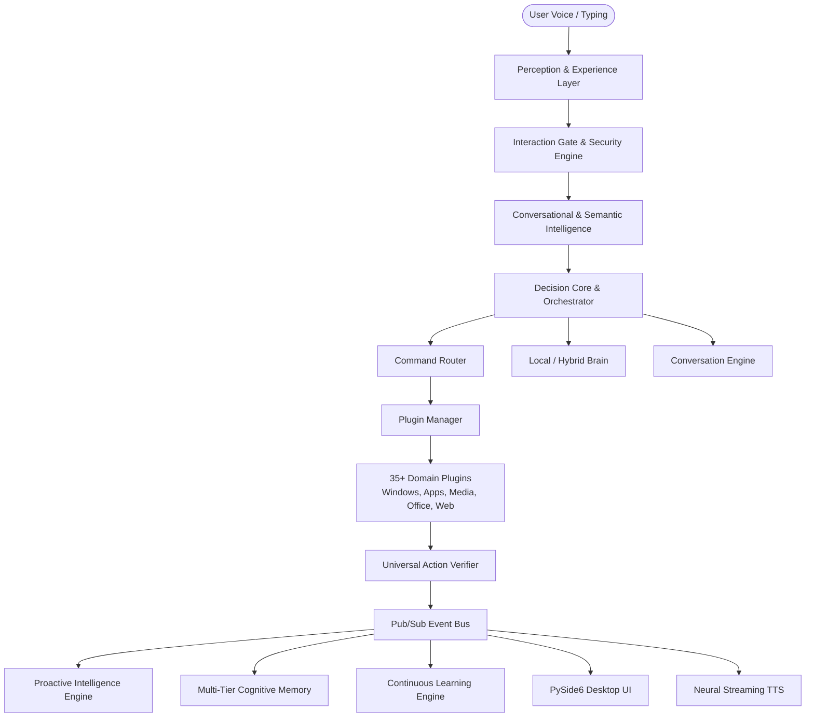
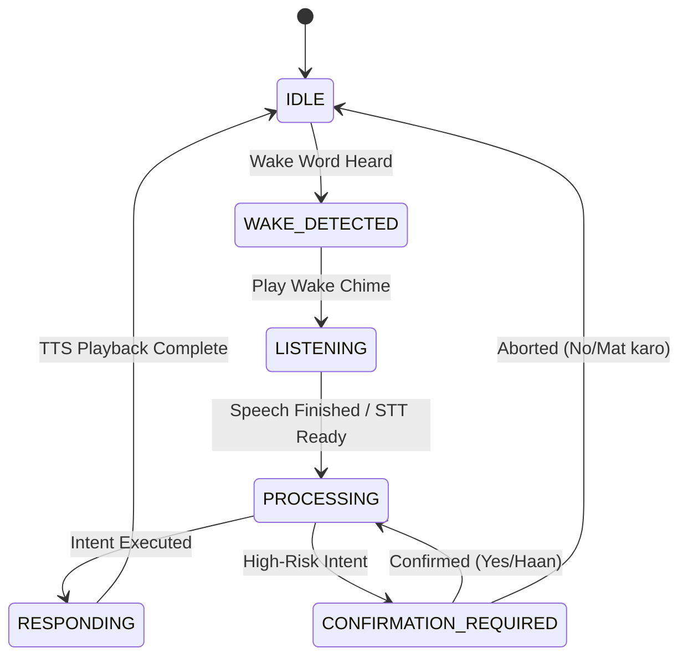
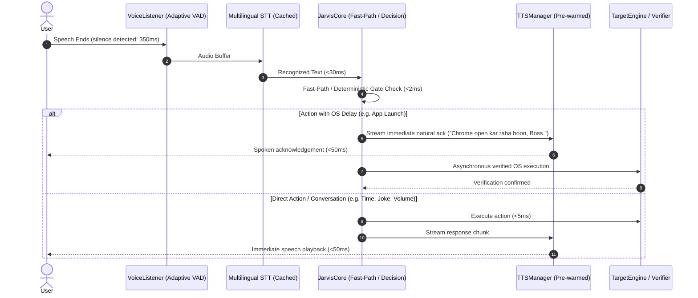

# JARVIS V2.1 — SYSTEM ARCHITECTURE
_Authoritative System Architecture & Engineering Blueprint_

---

## 1. High-Level System Architecture

Jarvis V2.1 is an offline-first, autonomous desktop cognitive assistant built with a modular, decoupled architecture. It bridges speech perception, computer vision, natural language understanding, multi-tier memory, and deterministic OS execution.



---

## 2. Core Architectural Layers

### 2.1 Presentation Layer (PySide6 Cyber-Dark GUI)
The Jarvis user interface is built on **PySide6 (Qt for Python)** with custom dark styling, responsive layouts, and telemetry cards across 9 integrated views:

- **DashboardView**: Real-time system telemetry (CPU, RAM, Uptime, Active Plugins, Active Target Context, Proactive AI Status, Fact Counts).
- **ChatView**: Interactive conversational interface supporting live speech transcripts, multi-turn history, command re-entry, and visual execution cards.
- **PluginsView**: Dynamic catalog of 35+ domain plugins with real-time capability inspection, activation toggles, keyword filters, and permission status.
- **MemoryView**: Tri-pane memory browser inspecting semantic facts, user preferences, and episodic dialogue logs with manual knowledge injection.
- **LearningView**: Behavior and habit discovery panel displaying auto-mined patterns, workflow generation triggers, and custom vocabulary training.
- **WorkflowsView**: Visual procedural automation runner allowing execution, editing, and parameterization of multi-step routines.
- **RemindersView**: Natural-language synchronized reminder list with countdown timers, recurring intervals, and audio alerts.
- **ActivityLogView**: Real-time structured log console coupled with an interactive desktop activity timeline.
- **SettingsView**: Central configuration center for voice/audio models, camera biometric parameters, proactive polling intervals, and privacy guardrails.

---

### 2.2 Perception & Experience Layer
- **Speech-to-Text (STT)**: Multilingual recognition supporting English, Hindi, and Hinglish. Employs acoustic preprocessing, phonetic normalizers, and STT error resilience.
- **Wake Word Engine**: Low-latency multi-engine trigger supporting Picovoice Porcupine, OpenWakeWord, and keyword fallback with sub-50ms response times.
- **Wake Chime Audio Feedback**: Immediate low-latency audio acknowledgement running on a dedicated Pygame sound playback thread.
- **Text-to-Speech (TTS)**: Dual-mode, ultra-low-latency speech synthesis engine utilizing Edge-TTS for natural neural voices (`hi-IN-SwaraNeural`, `en-US-ChristopherNeural`) with thread-safe Windows SAPI5 (`Microsoft Zira Desktop`) fallback. Features a zero-persistence in-memory audio lifecycle (direct `io.BytesIO` buffer playback via Pygame Mixer without accumulating `.mp3` files in `data/audio_cache`), background lookahead chunk prefetching, and guaranteed `try...finally` temporary file cleanup during fallbacks.
- **Screen Awareness & OCR**: Screen inspection integrating active window handle querying via Win32 API, browser active tab URL extraction, and optical character recognition (pytesseract).

---

### 2.3 Interaction Gate & Security Layer
- **Finite State Machine**:
  $$\text{IDLE} \longrightarrow \text{WAKE\_DETECTED} \longrightarrow \text{LISTENING} \longrightarrow \text{PROCESSING} \longrightarrow \text{RESPONDING} \longrightarrow \text{IDLE}$$
  The gate prevents ambient background speech, conference calls, and room echoes from triggering accidental command executions.
- **Biometric Face Authenticator**: Real-time OpenCV facial verification verifying user identity at startup and gating access to high-risk plugins (Financial, Email, WhatsApp, System Power). Features master PIN fallback and brute-force lockout safeguards.



---

### 2.4 8-Stage NLU & Semantic Understanding Pipeline
Jarvis processes user commands through an 8-stage pipeline designed for robustness against colloquial phrasing, STT inaccuracies, and mixed Hindi/English:

1. **Text Normalization**: Strips colloquial vocal filler words (*"bhai"*, *"zara"*, *"please"*), removes redundant punctuation, and cleans whitespace.
2. **Known Application & Entity Detection**: Intercepts registered Windows applications, store packages, and user-learned aliases via `WindowsAppResolver` and `EntityKnowledgeBase` prior to generic fuzzy matching.
3. **Context-Aware Spell & Typo Correction**: Corrects acoustic and typing corruptions (e.g., *"retstart"* $\rightarrow$ *"restart"*, *"youtub"* $\rightarrow$ *"youtube"*) while shielding valid domain terms.
4. **Synonym & Hinglish Normalization**: Normalizes Hindi/Hinglish action verbs (*"kholo"*, *"chalao"*, *"band karo"*, *"rok do"*) into canonical intents.
9. **Universal Meaning -> Goal Resolution (`UniversalGoalResolver`)**:
   Resolves natural phrasing against domain-specific goal handlers under `core/semantic/goals/`:
   - `CleanupGoalMixin`: Temporary data & Recycle Bin management.
   - `SoftwareUpdateGoalMixin`: Winget & OS software update plans.
   - `EquityResearchGoalMixin`: Indian equity research & catalyst analysis.
   - `ContextualGoalMixin`: Deictic pronouns, repetitions, and container follow-ups.
   - `CrossFeatureGoalMixin`: Multi-domain composite action goals.
10. **Universal Window & Application Resolution (`UniversalWindowResolver`)**:
   Eliminates exact string dependency by evaluating 8 weighted signals across running windows:
   $$\text{Process Exact (+95)} + \text{Collapsed Match (+92)} + \text{Window Title (+86)} + \text{Token Subset (+85)} + \text{Fuzzy Match (+60-80)} + \text{Foreground Bonus (+15)}$$
   Strips ASR noise suffixes (*"ID"*, *"App"*, *"Browser"*) via `UniversalAppNormalizer`, resolves deictic pronouns (*"yah window"*, *"isko"*), and checks actual OS states (`IsIconic`, `IsZoomed`) to deliver state-aware conversational feedback.

---

### 2.4a Canonical ConversationFrame — Shared Meaning Contract

**Location**: `brain/conversation/model.py` (`HumanConversationFrame`) + `core/conv_frame/frame.py` (`ConversationFrameBridge`)

Jarvis V2.2 introduces **meaning-first architecture**. Rather than re-parsing the raw utterance at every pipeline stage, a single **`HumanConversationFrame`** is produced once by `HumanConversationModel.analyze_turn()` at Step 2.HCM and then enriched by `ConversationFrameBridge` as downstream subsystems produce their outputs.

**Frame field ownership**:

| Layer | Owner | Fields Written |
|---|---|---|
| Speech | `SpeechUnderstandingEngine` | `input_quality`, `interpretation_status`, `recovery_status` |
| Semantic | `HumanConversationModel` | `communicative_goal`, `action`, `entity`, `target`, `is_negated`, `negation_scope` |
| Dialogue | `DialogueActClassifier` | `dialogue_act`, `previous_turn_relation` |
| Reference | `ReferenceResolver` | `resolved_reference`, `reference_confidence`, `resolver_used` |
| Context | `TopicTracker` + `ConversationState` | `active_workflow`, `active_goal`, `pending_question`, `slot_values` |
| Confidence | `ConfidenceEngine` | `intent_confidence`, `goal_confidence`, `overall_confidence` |
| Decision | `ConversationFrameBridge.derive_decision()` | `decision_type`, `execution_allowed`, `agent_required` |
| Execution | `DecisionCore` / `AgentOrchestrator` | **Consumes only** |
| Response | `ResponseEngine` | **Consumes only** |

**`FrameDecisionType`** enum (10 canonical values):
`EXECUTE_FAST`, `EXECUTE_AGENT`, `ANSWER`, `CONVERSE`, `CLARIFY`, `MEMORY_UPDATE`, `WAIT`, `CANCEL`, `REJECT`, `NO_ACTION`

**Invariant #10 guard**: When `frame.previous_turn_relation ∈ {ANSWER, CONTINUATION}` and a `pending_question` or `pending_goal` is active, the fast command path is bypassed so DialogManager can handle the slot fill.

---


Jarvis manages knowledge across multiple dedicated persistence tiers:

| Tier | Component | Scope & Purpose | Storage Backing |
|---|---|---|---|
| **Working Memory** | `WorkingMemory` | In-memory cache holding active window handles, current targets, and workflow state slots. | RAM / Process-local |
| **Short-Term Memory** | `ShortTermMemory` | Multi-turn conversational context covering recent entities and interactions. | RAM / Expiring Cache |
| **Episodic Memory** | `EpisodicMemory` | Permanent historical record of past conversations, queries, and user exchanges. | SQLite (`conversations`) |
| **Semantic Memory** | `SemanticMemory` | Knowledge base of user-stated facts, identity attributes, and system facts. | SQLite (`memories`) |
| **Procedural Memory** | `ProceduralMemory` | Executable structured routines and multi-step automated workflows. | SQLite (`workflows`, `task_workflows`) |
| **Activity Memory** | `ActivityMemory` | Historical time-series of observed window changes, idle periods, and app usage. | SQLite (`proactive_activity_events`) |

---

### 2.6 Proactive Intelligence & Observer Engine
Jarvis proactively assists without being intrusive:
- **ActivityObserver**: Low-overhead polling thread monitoring foreground window titles, active browser tabs, process IDs, and idle intervals.
- **PatternLearningEngine**: Mines recurrent habits (e.g., *"User always opens VS Code and Spotify between 9:00 AM and 9:30 AM"*).
- **PreferenceLearner**: Captures implicit preferences (preferred browser, music streaming player, work intervals) without requiring manual setup.
- **SuggestionManager**: Evaluates suggestion confidence and respects focus/distraction guardrails, ensuring notifications only occur during idle gaps or contextual transitions.

---

### 2.7 Execution Gateway & Universal Verification Layer
Execution safety and truth invariants are strictly enforced:
- **ExecutionStrategyEngine**: Translates action intents into platform-specific executions (Win32 API, UWP Protocol Launchers, PowerShell, PyAutoGUI, Browser Automation).
- **Universal Action Verification Layer**: Every execution requires post-action verification (e.g., window handle created, browser URL confirmed, process active) before claiming success. If verification cannot be confirmed, status is explicitly reported as `verification_unknown` rather than falsely reported as failed or successful.
- **Multi-Entity Command Engine**: Parses compound instructions (e.g., *"Chrome kholo aur usme YouTube play karo"*), decomposing them into an atomic execution sequence with dependency tracking.

---

### 2.8 Zero-Downtime Live Update & Reloader
Jarvis includes an in-process live reload architecture:
- **LiveUpdateManager**: File-watcher monitoring source code changes with debounced batching.
- **ReloadPolicy Categories**:
  - `HOT_RELOAD_SAFE`: In-process module re-import and EventBus subscriber re-registration.
  - `WORKER_RESTART_REQUIRED`: Quiesces worker thread, reloads module, and restarts thread.
  - `FULL_RESTART_REQUIRED`: Emits status warning without abruptly terminating the PySide6 UI.
- Prevents UI flickering or process aborts during active development.

---

### 2.9 Ultra-Low Latency Conversational Response Pipeline
Jarvis V2.1 features an optimized end-to-end response pipeline engineered to minimize time-to-first-audio while preserving dialogue state, safety verification, and natural speech cadence:



- **Adaptive VAD Silence Detection**: Automatically tightens silence threshold to 350ms for fluent command delivery while providing 550ms for hesitations.
- **Persistent STT & Vocabulary Caching**: Eliminates per-utterance recognizer instantiations and regex compilation overheads (`SpellingResolver._CACHED_TERMS`).
- **Non-blocking TTS Streaming & Barge-In**: TTS playback runs asynchronously with sentence streaming; speaking state allows instant user interruption without stalling listeners.
- **Target Engine Short-Circuiting**: Bypasses DevTools port sweeps when no browser processes are detected, cutting headless target resolution from 780ms to <12ms.
- **End-to-End Latency Tracking**: Integrated `PipelineLatencyTracker` records sub-millisecond stage metrics across `STT`, `Intent`, `Planning`, `Action`, `TTS_Startup`, and `TOTAL_RESPONSE`.

---

### 2.10 Human-Like Conversational Response & Feedback Policy
Jarvis enforces the **Direct Answer $\rightarrow$ Optional Useful Detail $\rightarrow$ Stop** invariant across conversational status and screen queries via `ConversationalResponsePolicy` (`core/response_policy.py`):
- **Concise, Human-Like Status**: Simple status questions (*"Chrome open hai kya?"*) return exactly one direct, natural sentence (*"Haan, Chrome open hai."*).
- **Zero Technical Metadata**: Internal process names (`chrome.exe`), window handles (`hwnd`), raw filesystem paths, and debug brackets (`('Title')`) are strictly filtered out of conversational feedback.
- **Context-Aware Specificity**: Distinguishes affirmative checks, negative checks (*"open nahi hai na?"*), active checks (*"active hai kya?"*), and window specificity checks (*"kaunsa window open hai?"*). Only includes sanitized window titles or minimized/background state when explicitly requested or contextually necessary.

---

### 2.11 Conversational Intent & Speech-Act Classification Layer
Jarvis enforces the **Purpose First $\rightarrow$ Execute Second $\rightarrow$ Speak Naturally Third** invariant via `ConversationalIntentClassifier` (`core/conversational_intent.py`) positioned directly before command execution:
- **Speech-Act Disambiguation**: Categorizes user speech into distinct pragmatic classes (`CAPABILITY_QUESTION`, `ACTION_COMMAND`, `STATUS_QUESTION`, `STATUS_AFTER_ACTION`, `INFORMATION_QUESTION`, `CONFIRMATION`, `CANCELLATION`, `CLARIFICATION`, `TROUBLESHOOTING`, `GREETING`, `CONVERSATION`, `FOLLOW_UP`).
- **Capability Gating**: Capability inquiries (*"kya tum system lock kar sakte ho?"*, *"can you open Chrome?"*) are answered with capability confirmations (*"Haan, main system lock kar sakta hoon."*) and **never** trigger action execution.
- **Troubleshooting & Diagnostics**: Troubleshooting inquiries (*"system lock kyun nahi ho raha?"*, *"Chrome kyun nahi khul raha?"*) evaluate operational constraints and report explanations rather than blindly re-executing.
- **Status Non-Mutation Invariant**: Status queries (*"system lock hai kya?"*, *"Chrome open hua?"*) perform read-only inspection and strictly forbid mutating system state.
- **Confirmation Safety Invariant**: Standalone confirmations (*"haan"*, *"theek hai"*) only trigger execution when an active pending confirmation or proposal exists in context. Otherwise, they receive natural conversational feedback (*"Ji, batayein kya karna hai?"*).

---

### 2.12 Knowledge-Based General Knowledge (GK) Engine & Semantic Fact Layer
Jarvis incorporates a structured knowledge-based architecture (`core/knowledge/`) enforcing the **Structured Knowledge First $\rightarrow$ Zero Q&A Duplication $\rightarrow$ Strict Anti-Hallucination** invariant:
- **Entity & Fact Model**: Stores structured entities, properties, and relational triples across 16 categories (countries, capitals, states, currencies, continents, planets, elements, history, famous people, acronyms, science basics, geography, Indian GK, computer technology facts) rather than thousands of memorized natural language Q&A rows.
- **Natural Variation Normalization**: Resolves diverse multilingual phrasings (*"India ki capital kya hai?"*, *"Bharat ki rajdhani kya hai?"*, *"What is the capital of India?"*, *"Tell me India's capital"*) to the single entity `India` and property `capital`.
- **Reasoning Layer**: Evaluates conceptual questions (*"Why does the sky appear blue?"*, *"Photosynthesis kya hota hai?"*, *"Explain gravity simply"*) using structured bilingual conceptual models without requiring exact question matches.
- **Time-Sensitive Gating**: Distinguishes static knowledge from fresh live inquiries (current prime minister, live weather, real-time stock prices, latest news), protecting against stale responses.
- **Confidence Tiers & Anti-Hallucination**:
  - `HIGH` ($\ge 0.80$): Direct concise conversational answer (target: 1 sentence).
  - `MEDIUM` ($0.60 - 0.79$): Qualified contextual answer.
  - `LOW` ($< 0.60$): Transparent refusal (*"Is baare mein mere paas abhi reliable jaankari uplabdh nahi hai, Boss."*); **NEVER** fabricates or hallucinates facts.
- **Command & Capability Isolation**: Capability questions (*"kya tum system lock kar sakte ho?"*) are intercepted by the Speech-Act gating layer upstream and are never treated as GK or action commands.

---

### 2.11 IT & Infrastructure Technical Knowledge Engine (`core.knowledge.it`)
A specialized subsystem extending general knowledge to provide authoritative, experienced systems administrator guidance across enterprise computing environments:
- **Domains Covered**:
  1. **Windows Desktop (10/11)**: OS settings, services, Task Manager, Event Viewer, Device Manager, Registry, Firewall, BitLocker, permissions, mapped drives, RDP, PowerShell, CMD.
  2. **Windows Server 2019**: AD DS, Domain Controller, DNS Server, DHCP Server, Group Policy (GPO), OUs, NTFS/Share permissions, SMB, IIS, Hyper-V, Storage Spaces, RAID (0/1/5/10), PKI/Certificates, Kerberos vs NTLM, PowerShell admin.
  3. **Microsoft Azure**: Subscriptions, Resource Groups, Regions, Availability Zones, Azure VMs, VNets & Subnets, NSG, Public/Private IPs, Azure DNS, Storage Accounts (Blob/Files/Disks), Entra ID, RBAC, Key Vault, Azure Monitor & Log Analytics.
  4. **Networking**: TCP/IP, OSI model, IPv4/IPv6 subnetting (CIDR), DNS/DHCP, NAT, routing/switching, VLANs, VPNs, port reference (80, 443, 3389, 53, 67, 88, 445).
  5. **Enterprise Infrastructure**: SAN vs NAS storage, 3-2-1 backup rule & DR (RTO/RPO), patch management (WSUS/Intune/SCCM), endpoint management.
- **6-Phase Structured Troubleshooting Schema**:
  $$\text{Problem Identification} \longrightarrow \text{Likely Causes} \longrightarrow \text{Safe Checks} \longrightarrow \text{Commands/Tools} \longrightarrow \text{Possible Fixes} \longrightarrow \text{Verification Steps}$$
- **Safe Command Catalog**: Safe technical specifications for `ipconfig`, `ping`, `tracert`, `nslookup`, `netstat`, `sfc`, `DISM`, `gpupdate`, `whoami`, `Test-NetConnection`, `Get-ADUser`, `Get-DnsServerZone`, `az vm`, etc. Commands are explained with syntax and safe examples; **commands are NEVER executed on knowledge queries**.
- **Multi-Turn Context Tracking**: Maintains `active_domain`, `active_concept`, and procedure steps within a 5-minute TTL window, enabling natural follow-ups (*"ab next kya karu?"*) without requiring the user to repeat previous context.
- **Anti-Hallucination & Microsoft Learn Alignment**: References official Microsoft documentation, RFC standards, and flags version-sensitive queries for live verification.

---

### 2.12 Calendar & Festival Knowledge Engine (`core.knowledge.calendar`)
A dedicated sub-system providing intelligent, year-aware resolution of Indian festival dates, national observances, and date-based cultural events:

**Architecture Pipeline:**
```
QUERY → FestivalIntentClassifier → YearInferenceEngine → FestivalStore
  → FestivalDateResolver → FestivalResponseFormatter → KnowledgeQueryResult
```

**Core Components:**
- **`FestivalCalendarEngine`** (`engine.py`): Main orchestrator. Checks `is_calendar_candidate()` before the general entity pipeline (inserted as Step 3.5 in `KnowledgeRouter.route_query()`), preventing festival date queries from being misrouted to generic entity or time-sensitive handlers.
- **`FestivalStore`** (`festival_store.py`): Authoritative data store for 30+ Indian festivals and national days with pre-verified date entries for years 2024–2028 (sourced from Drik Panchang and Government of India calendars). Maintains a case-insensitive alias index for O(1) festival lookup. Fixed-date observances (national days, Christmas) store entries for 2024–2034.
- **`YearInferenceEngine`** (`year_inference.py`): Resolves the target year from a query. **CRITICAL INVARIANT: The current year is ALWAYS read from `datetime.now().year` at runtime — never from a hardcoded constant.** Handles explicit years ("2027 mein Diwali"), relative tokens ("agle saal", "pichle saal", "is saal"), and defaults to system clock.
- **`FestivalIntentClassifier`** (`intent_classifier.py`): Classifies queries into `FESTIVAL_DATE_QUERY`, `FESTIVAL_DEFINITION`, `FESTIVAL_DURATION`, `UPCOMING_FESTIVAL`, `MONTH_FESTIVAL`, `NATIONAL_DAY_QUERY`, `GENERAL_DATE_QUERY` (routed to `TimeContext`), and `NOT_CALENDAR`. **Action commands** (e.g., "reminder laga do") are explicitly excluded.
- **`FestivalResponseFormatter`** (`formatter.py`): Generates natural Hinglish/English date answers, definitions, duration summaries, and upcoming festival announcements.

**Festival Coverage (30+ entries):**
- *Lunar/Hindu*: Ganesh Chaturthi, Diwali, Dussehra, Holi, Janmashtami, Ram Navami, Navratri, Raksha Bandhan, Mahashivratri, Guru Purnima, Buddha Purnima, Mahavir Jayanti, Guru Nanak Jayanti, Chhath Puja, Basant Panchami, Karwa Chauth, Teej, Durga Puja
- *Regional*: Onam, Baisakhi, Pongal, Makar Sankranti
- *Islamic*: Eid ul-Fitr, Eid ul-Adha (approximate lunar dates)
- *Christian*: Christmas (fixed)
- *National Days*: Republic Day (26 Jan), Independence Day (15 Aug), Gandhi Jayanti (2 Oct), Teachers' Day (5 Sep), Children's Day (14 Nov), Constitution Day (26 Nov), National Science Day (28 Feb)

**Key Invariants:**
- Anti-hallucination: For years not in the data store (e.g., 2035), the engine gives an honest refusal rather than fabricating a date.
- Alias collision prevention: Festival aliases do not overlap with any existing GK/IT/command intent keywords.
- Action isolation: Queries containing action verbs ("laga do", "set karo", "remind") are classified as `NOT_CALENDAR` and passed to the command routing layer.
- `GENERAL_DATE_QUERY` ("aaj date kya hai?") signals `forward_to_time_context=True` and falls through to `TimeContext`, not the festival engine.

**STT Normalization (`normalizer.py`):** Festival-specific phonetic corrections added (e.g., `ganpathy → ganpati`, `deepawali → diwali`, `rakhi → raksha bandhan`).

---

### 2.13 Autonomous Personal AI Agent & Computer Agent Layer (`core.agent`)
Evolves Jarvis into a genuine Computer Agent while strictly preserving existing low-latency fast execution:
- **Dual-Path Routing Architecture**:
  - **Fast Path**: Single, deterministic commands (*"Chrome kholo"*, *"volume 50 karo"*, *"AntiGravity minimize karo"*) route through `FastPathEngine` / `WindowManager` in $< 15\text{ ms}$.
  - **Agent Path**: Compound, multi-step, goal-oriented, or ambiguous requests route through `AgentOrchestrator` (`core/agent/orchestrator.py`).
- **Request Classification (`RequestClassifier`)**: Classifies inputs into 6 deterministic types: `DIRECT_COMMAND`, `INFORMATION_REQUEST`, `CONVERSATIONAL`, `MULTI_STEP_TASK`, `GOAL_ORIENTED_TASK`, and `AMBIGUOUS_TASK`.
- **Goal Formation & Task Decomposition (`AgentPlanner`)**: Decomposes complex user requests into directed dependency step graphs (`AgentTask` $\rightarrow$ `AgentStep`s), resolving deictic demonstrative pronouns (*"AntiGravity kholo aur usko minimize karo"* $\rightarrow$ maps "usko" to AntiGravity).
- **Single Source of Truth Tool Registry (`ToolRegistry`)**: Wraps existing Jarvis capabilities (`WindowsAppResolver`, `WindowManager`, `FilesystemOperations`, `BrowserTabManager`, telemetry) into bounded tools without duplicating implementation logic.
- **Ground-Truth Observation & Universal Verification**:
  - `AgentObserver`: Captures active foreground HWND, matching processes, and Windows state flags (`IsIconic` minimization checks).
  - `AgentVerifier`: Enforces outcome truth using `ExecutionVerificationLayer`.
- **Adaptive Recovery & Dynamic Replanning**:
  - `FailureRecoveryEngine`: Automatically diagnoses failures (e.g., app already running $\rightarrow$ adapts to window restore/focus rather than re-launching).
  - `AgentReplanner`: Substitutes alternative capabilities (e.g., browser web version fallback) when desktop actions fail permanently.
- **Execution Safety & Confirmation Gates (`AgentPolicy`)**: Bounded retries (`max_retries_per_step = 2`), plan step ceilings (`max_total_steps = 10`), human-in-the-loop approval gates for `HIGH`/`CRITICAL` risk operations, and simulation mode (`AGENT_DRY_RUN=true`).
- **Full Specification**: See [docs/AGENT_ARCHITECTURE.md](file:///c:/Data/Jarvis_19-09-2026/docs/AGENT_ARCHITECTURE.md) for complete technical blueprints, state machines, and scenario traces.

---

## 3. Storage & Persistence Topology

All persistent state is unified under `data/jarvis.db` managed via `DatabaseManager`:
- **SQLite WAL Mode**: Enabled via `PRAGMA journal_mode = WAL;` and `PRAGMA synchronous = NORMAL;` to support concurrent reader and writer threads without locking.
- **Tables**:
  - `users`, `preferences`: User configuration, role permissions, and UI themes.
  - `memories`, `conversations`: Semantic facts and episodic dialogue history.
  - `entities`, `corrections`, `learned_vocabulary`: Domain terms, phonetic mappings, and aliases.
  - `website_knowledge`: Canonical URLs, verified domain aliases, and usage counters.
  - `learned_patterns`: Mined behavioral routines and habit sequences.
  - `workflows`, `task_workflows`, `task_checkpoints`: Multi-step automation definitions.
  - `proactive_activity_events`: Audit trail of desktop activities.

---

## 4. Pub/Sub EventBus Specification

The decoupled `EventBus` facilitates asynchronous, isolated inter-component communication:

```text
EventTopics:
  ├── user.input.received
  ├── voice.wakeword.detected
  ├── intent.classified
  ├── action.planned
  ├── execution.started
  ├── execution.completed
  ├── task.started / task.completed
  ├── memory.created
  ├── learning.detected
  ├── proactive.suggestion.proposed
  ├── activity.observed
  ├── plugin.loaded / plugin.error
  └── system.state.changed
```

All handlers are isolated in try-catch boundaries: an error in a subscriber cannot crash the event publisher or the event dispatch pipeline.
